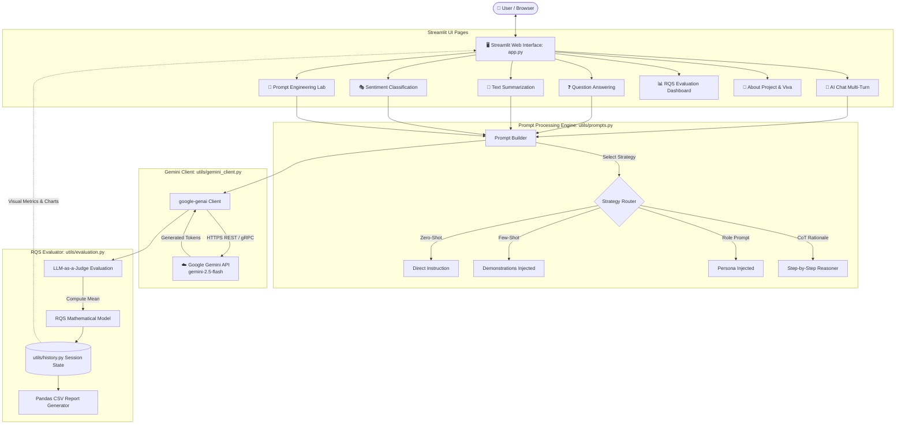

# 🧪 PromptLab AI — Chatbot using LLM with Prompt Engineering

[](https://www.python.org/)
[](https://streamlit.io/)
[](https://aistudio.google.com/)
[](https://opensource.org/licenses/MIT)

> **College NLP Practical Project**  
> **Title:** *Chatbot using LLM with Prompt Engineering*  
> **Developed by:** Adinath Ugale (Project Creator & Developer)  
> **Target Platform:** Streamlit Community Cloud & Local Windows / macOS / Linux  

---

## 📑 Table of Contents

1. [Project Overview & Aim](#1-project-overview--aim)
2. [Problem Statement & Objectives](#2-problem-statement--objectives)
3. [Software & Hardware Requirements](#3-software--hardware-requirements)
4. [Theoretical Background](#4-theoretical-background)
5. [Mathematical Model: Response Quality Score (RQS)](#5-mathematical-model-response-quality-score-rqs)
6. [System Architecture & Flowchart](#6-system-architecture--flowchart)
7. [System Algorithm](#7-system-algorithm)
8. [Project Structure](#8-project-structure)
9. [Prompt Engineering Strategies Implemented](#9-prompt-engineering-strategies-implemented)
10. [Core NLP Tasks & Sample Inputs/Outputs](#10-core-nlp-tasks--sample-inputsoutputs)
11. [Local Setup Guide (Windows & Cross-Platform)](#11-local-setup-guide-windows--cross-platform)
12. [Automated Testing & Test Results](#12-automated-testing--test-results)
13. [Deployment Guide (GitHub + Streamlit Cloud)](#13-deployment-guide-github--streamlit-cloud)
14. [Limitations & Future Scope](#14-limitations--future-scope)
15. [College Viva & Presentation Defense Guide](#15-college-viva--presentation-defense-guide)

---

## 1. Project Overview & Aim

**PromptLab AI** is an interactive, academic-grade generative AI web application that demonstrates the practical capabilities of Large Language Models (LLMs) paired with systematic prompt engineering methodologies. Connected directly to the official **Google Gemini API** (`google-genai` SDK), it performs three foundational Natural Language Processing (NLP) tasks:

1. **Question Answering (QA)** with uncertainty grounding and academic explanation.
2. **Text Summarization** with factual preservation across short, medium, and detailed modes.
3. **Sentiment Classification** with deterministic polarity badges (Positive, Negative, Neutral) and semantic rationale.

Additionally, PromptLab AI includes an interactive **Prompt Engineering Lab** comparing prompt strategies side-by-side, and an automated **Response Quality Evaluation Dashboard** based on a rigorous mathematical model (**RQS**).

---

## 2. Problem Statement & Objectives

### Problem Statement
Standard LLM deployments often suffer from:
- **Hallucinations and ungrounded outputs** when users provide vague, unconstrained prompts.
- **Inconsistent formatting and unpredictability** across varying user intents.
- **Lack of standardized quality evaluation metrics** to measure answer fidelity and consistency.
- **Opaque prompting logic**, where end-users cannot inspect how instructions influence model behavior.

### Project Objectives
- **Demonstrate Real LLM Integration**: Implement live API calls to Google Gemini (`gemini-2.5-flash` / `gemini-1.5-flash`) via the modern `google-genai` SDK without mocking or simulations in production.
- **Formalize Prompt Engineering**: Compare **Zero-Shot**, **Few-Shot**, **Role Prompting**, and **Chain-of-Thought (Rationale)** paradigms on identical inputs.
- **Mathematical Evaluation**: Implement the **Response Quality Score (RQS)** framework combining Accuracy, Relevance, Consistency, and Fluency on an interval scale of $1.0$ to $5.0$.
- **Production-Grade Deployment**: Build a responsive Streamlit UI deployable to **Streamlit Community Cloud** with secure environment secrets.

---

## 3. Software & Hardware Requirements

### Software Requirements
| Component | Specification |
| :--- | :--- |
| **Operating System** | Windows 10/11, Ubuntu 20.04+, macOS Sonoma+ |
| **Runtime** | Python 3.10, 3.11, or 3.12 |
| **Web Framework** | Streamlit $\ge$ 1.35.0 |
| **Generative AI SDK** | `google-genai` $\ge$ 1.0.0 (Official Google SDK) |
| **Environment Management** | `python-dotenv` $\ge$ 1.0.0 |
| **Data Processing** | Pandas $\ge$ 2.0.0 |
| **Testing Framework** | Pytest $\ge$ 8.0.0 |
| **Visualization** | Altair $\ge$ 5.0.0 |

### Hardware Requirements
- **Processor**: Any dual-core Intel/AMD CPU or Apple Silicon (inference is offloaded to Google AI Cloud).
- **RAM**: Minimum 4 GB RAM (8 GB recommended for local development).
- **Disk Space**: ~300 MB for virtual environment and dependencies.
- **Network**: Active broadband connection for HTTPS communication with Gemini endpoints.

---

## 4. Theoretical Background

### Large Language Models (LLMs)
Modern LLMs are autoregressive deep neural networks based on the **Transformer architecture** (Vaswani et al., 2017). They model the conditional probability distribution of sequences of text tokens:

$$P(W) = \prod_{t=1}^T P(w_t \mid w_1, w_2, \dots, w_{t-1})$$

### Prompt Engineering vs. Fine-Tuning
While fine-tuning alters model weights via backpropagation on specialized labeled datasets, **prompt engineering** leverages *in-context learning* (Brown et al., 2020). By structuring instructions, system roles, and exemplars in the inference context window, we steer foundation models with zero parameter modifications.

---

## 5. Mathematical Model: Response Quality Score (RQS)

To systematically evaluate model output quality across varying prompt configurations, we define the **Response Quality Score (RQS)** as the arithmetic mean of four normalized evaluation dimensions:

$$\text{RQS} = \frac{\text{Accuracy} + \text{Relevance} + \text{Consistency} + \text{Fluency}}{4}$$

Where:
- $\text{Accuracy} \in [1.0, 5.0]$: Factual correctness, absence of hallucinations, and fidelity to domain ground truth.
- $\text{Relevance} \in [1.0, 5.0]$: Extent to which the response directly addresses the user query without conversational drift.
- $\text{Consistency} \in [1.0, 5.0]$: Internal logical cohesion, absence of self-contradictions, and adherence to negative constraints.
- $\text{Fluency} \in [1.0, 5.0]$: Syntactic precision, grammatical correctness, vocabulary richness, and readability.

The resulting score satisfies:

$$\text{RQS} \in [1.0, 5.0]$$

| Score Range | Qualitative Interpretation |
| :---: | :--- |
| **4.5 – 5.0** | **Exceptional**: Publication-ready, factually grounded, flawless syntax. |
| **3.5 – 4.4** | **Good / High Quality**: Minor stylistic or non-critical omission; solid reasoning. |
| **2.5 – 3.4** | **Fair / Marginal**: Contains minor factual inaccuracies or slight drift. |
| **1.0 – 2.4** | **Unsatisfactory**: Severe hallucinations, off-topic, or syntactically broken. |

---

## 6. System Architecture & Flowchart

### Mermaid System Architecture



---

## 7. System Algorithm

```text
Algorithm: PromptLab AI Execution & Evaluation Pipeline
-------------------------------------------------------
Input: User text input (T_in), NLP Task (K), Prompt Strategy (S), Generation Parameters (temp, model)
Output: Generated Response (R_out), Latency (L_ms), RQS Evaluation (E_rqs)

1. VALIDATION:
   IF T_in is empty OR len(T_in.strip()) < min_threshold THEN
       Emit user-facing validation error and HALT.

2. PROMPT CONSTRUCTION:
   system_instruction, formatted_prompt = build_prompt(K, S, T_in)

3. API INVOCATION:
   start_time = high_resolution_clock()
   TRY:
       client = get_gemini_client()
       response = client.models.generate_content(
           model=model,
           contents=formatted_prompt,
           config=GenerateContentConfig(
               system_instruction=system_instruction,
               temperature=temp
           )
       )
       R_out = response.text
   CATCH APIError as exc:
       R_out = format_api_error(exc)
       HALT and render error banner.
   L_ms = (high_resolution_clock() - start_time) * 1000

4. RESPONSE EVALUATION (RQS):
   IF Evaluation is requested:
       judge_output = evaluate_response_with_llm(client, model, K, S, T_in, R_out)
       Extract {Accuracy, Relevance, Consistency, Fluency}
       VALIDATE each score in [1.0, 5.0]
       RQS_score = (Accuracy + Relevance + Consistency + Fluency) / 4.0
       Log record to Pandas DataFrame in session state.

5. PRESENTATION:
   Render R_out, latency badge, formatted prompt inspection expander, and RQS metrics cards.
```

---

## 8. Project Structure

```text
promptlab-ai/
├── app.py                     # Main Streamlit web application & UI navigation
├── requirements.txt           # Project dependencies (Streamlit, google-genai, pandas, pytest)
├── .env.example               # Environment variables template (API Key & model defaults)
├── .gitignore                 # Excludes .env, secrets, venv, and cache files from Git
├── README.md                  # Comprehensive academic documentation and setup guide
├── .streamlit/
│   └── config.toml            # Streamlit theme (modern dark palette) & server settings
├── utils/
│   ├── __init__.py            # Package exports
│   ├── gemini_client.py       # Google GenAI client, ping check, and error handlers
│   ├── prompts.py             # Prompt strategies, templates, few-shot exemplars, input validation
│   ├── evaluation.py          # RQS formula, LLM judge, score validation, CSV export
│   └── history.py             # Session state storage, clear chat, query counters
└── tests/
    ├── __init__.py            # Test package marker
    ├── test_prompts.py        # Unit tests for prompt generation and validation
    ├── test_evaluation.py     # Unit tests for RQS math and DataFrame exports
    ├── test_gemini_client.py  # Unit tests mocking Google GenAI SDK and errors
    └── test_live_api.py       # Optional live integration test against Gemini
```

---

## 9. Prompt Engineering Strategies Implemented

### 1. Zero-Shot Prompting
Sends the direct task instructions to the LLM without demonstration examples.  
*Best for:* Standard general-purpose technical queries and fast response times.

### 2. Few-Shot Prompting
Injects 2–3 carefully curated demonstrations into the prompt context before the user's input.  
*Best for:* Strict output formatting, predictable categorization, and domain style alignment.

### 3. Role Prompting
Assigns an authoritative persona to the model (e.g., *Senior NLP Professor*, *Executive Intelligence Analyst*, *Computational Linguist*).  
*Best for:* Nuanced explanations, empathetic pedagogical tone, and specialized technical depth.

### 4. Chain-of-Thought (Rationale)
Prompts the model to provide explicit intermediate reasoning anchors or rationale before delivering the final answer.  
*Best for:* Complex multi-step reasoning, semantic decomposition, and explainability.

---

## 10. Core NLP Tasks & Sample Inputs/Outputs

### Task 1: Question Answering (QA)
- **Input:** *"What is Self-Attention and how does it compute query, key, and value vectors?"*
- **Role Persona:** Professor Alan, Senior NLP Researcher.
- **Sample Output:**  
  > *"Self-Attention allows a model to weigh the relative importance of all other words in a sentence when encoding a specific token. It projects input embeddings into three vectors: Query ($Q$), Key ($K$), and Value ($V$). The attention weights are computed as:*
  > $$\text{Attention}(Q, K, V) = \text{softmax}\left(\frac{QK^T}{\sqrt{d_k}}\right)V$$
  > *This resolves the fixed-vector information bottleneck seen in traditional recurrent networks."*

---

### Task 2: Text Summarization
- **Input:** 250-word text explaining Transformer training, self-supervised learning, and RLHF.
- **Length Mode:** Medium (3–5 bullet points).
- **Sample Output:**
  > - *Foundation models are pretrained on massive web text using autoregressive self-supervised objectives.*
  > - *Post-pretraining involves Supervised Fine-Tuning (SFT) on curated instruction-following datasets.*
  > - *Reinforcement Learning from Human Feedback (RLHF) aligns model responses with human helpfulness and safety criteria.*

---

### Task 3: Sentiment Classification
The project provides three pre-configured practical test benchmarks:

| Input Text | Expected Ground Truth | Actual Gemini Output | Badge |
| :--- | :---: | :---: | :---: |
| *"This phone has excellent battery life."* | **Positive** | `Label: Positive` | 🟢 POSITIVE |
| *"The product quality is terrible."* | **Negative** | `Label: Negative` | 🔴 NEGATIVE |
| *"The package arrived yesterday."* | **Neutral** | `Label: Neutral` | 🔵 NEUTRAL |

*Gemini rationale output for Neutral sample:*  
> *"The input conveys an objective, factual timeline of delivery without positive or negative emotional polarity."*

---

## 11. Local Setup Guide (Windows & Cross-Platform)

### Step 1: Open PowerShell or Command Prompt
Navigate to your project directory:

```powershell
cd c:\Users\Aadi\OneDrive\Documents\Adinath\CHATBOT
```

### Step 2: Create and Activate Virtual Environment

**In Windows PowerShell:**
```powershell
python -m venv .venv
.\.venv\Scripts\Activate.ps1
```
*(If PowerShell displays an `Execution_Policies` restriction, run `Set-ExecutionPolicy -Scope Process -ExecutionPolicy Bypass` and rerun the activation script).*

**In Windows Command Prompt (CMD):**
```cmd
python -m venv .venv
.\.venv\Scripts\activate.bat
```

### Step 3: Upgrade Pip & Install Dependencies
```powershell
python -m pip install --upgrade pip
pip install -r requirements.txt
```

### Step 4: Configure Gemini API Key
Create a local `.env` file from `.env.example`:

**In PowerShell:**
```powershell
Copy-Item .env.example .env
```
**In CMD:**
```cmd
copy .env.example .env
```

Open `.env` in any text editor and supply your Google Gemini API key:
```env
GEMINI_API_KEY=AIzaSyYourActualKeyHere
GEMINI_MODEL=gemini-2.5-flash
```
*(Obtain a free API key at [Google AI Studio](https://aistudio.google.com/)).*

### Step 5: Start Streamlit Application
```powershell
python -m streamlit run app.py
```

### Expected Local Address:
The application will launch in your browser at:
```text
http://localhost:8501
```

---

## 12. Automated Testing & Test Results

The test suite contains thorough unit tests mocking all Gemini API calls (consuming zero API quota) and testing all prompt permutations, RQS mathematical models, boundary conditions, and error handlers.

### Running Automated Tests
```powershell
pytest -v
```

### Test Coverage Highlights:
- `tests/test_prompts.py`: 12 test assertions covering all 3 tasks, all 4 strategies, input validation limits, and prompt display privacy.
- `tests/test_evaluation.py`: 14 test assertions covering arithmetic mean, score bounds $[1.0, 5.0]$, rejection of non-numeric inputs, JSON parsing from Markdown blocks, and CSV generation.
- `tests/test_gemini_client.py`: 8 test assertions covering 429 quota exhaustion formatting, 401/403 invalid key handling, 404 model not found, timeout mapping, and mocked chat history role conversions.

---


## 14. Limitations & Future Scope

### Limitations
1. **API Quota & Rate Limits**: Free tier keys on Google AI Studio enforce rate limits (typically 15 Requests Per Minute). Concurrent requests during a live college demo may hit HTTP 429. PromptLab AI catches this error gracefully.
2. **LLM-as-a-Judge Heuristics**: Automated RQS scoring is estimated by an LLM evaluator. While structured and prompt-grounded, it remains a heuristic estimate rather than absolute human ground truth.
3. **Session-Only Memory**: Conversational memory resides in Streamlit's session state and resets if the browser tab is refreshed.

### Future Scope
- **Vector Retrieval Augmented Generation (RAG)**: Integrate ChromaDB / FAISS for uploading custom PDF textbooks and grounding answers in uploaded college notes.
- **Multi-Modal Support**: Add image and audio prompt inputs using Gemini's native multi-modal capabilities.
- **Export Formats**: Support PDF synthesis for generated study guides and summaries.

---

## 15. College Viva & Presentation Defense Guide

### Top Viva Questions & Model Answers

**Q1: What is the main objective of this project?**  
*Answer:* The objective is to construct an operational, full-stack NLP web application that applies foundational prompt engineering paradigms (Zero-Shot, Few-Shot, Role Prompting, CoT) to Large Language Models (Google Gemini), benchmarks outputs through a novel mathematical framework (RQS), and offers a user-friendly laboratory for comparative analysis.

**Q2: What is the difference between extractive and abstractive summarization? Which one does Gemini perform?**  
*Answer:* Extractive summarization extracts sentences directly verbatim from the source text. Abstractive summarization understands the semantic concepts and generates new sentences from scratch. Gemini performs state-of-the-art *abstractive summarization*, which we guide with length constraints and factual grounding instructions.

**Q3: How does Few-Shot prompting work under the hood?**  
*Answer:* LLMs are next-token predictors. When we provide 2–3 exemplar pairs (`Input: ... -> Output: ...`) inside the prompt context, the self-attention mechanism attends to these patterns, establishing high attention weights for similar syntactic structures, formatting tags, and semantic categories.

**Q4: How did you calculate RQS?**  
*Answer:* RQS (Response Quality Score) is calculated as $RQS = \frac{\text{Accuracy} + \text{Relevance} + \text{Consistency} + \text{Fluency}}{4}$, where each metric is scored from $1.0$ to $5.0$. It provides a single, balanced metric capturing both correctness and linguistic expression.

**Q5: Why did you use `google-genai` instead of the legacy `google-generativeai`?**  
*Answer:* `google-genai` is Google's new, unified official Python SDK supporting the latest Gemini 2.0 and 2.5 foundation models, unified configuration schemas (`GenerateContentConfig`), and enhanced stability.

---

*PromptLab AI — NLP Practical Project | Developed with Python, Streamlit, and Google Gemini API.*
